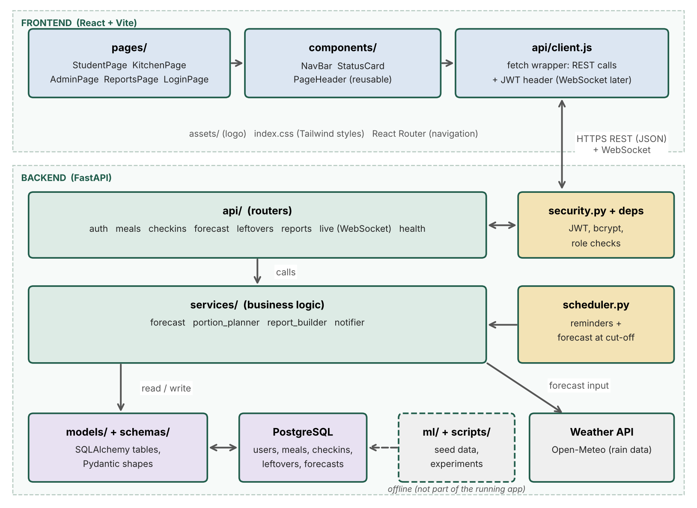

# MessMeter

A web app that predicts how many students will eat each meal in a hostel mess, so the kitchen cooks the right amount.
Students tap **Eating** or **Skipping** before each meal; the kitchen sees a headcount forecast and a portion plan.

Built for the UNAI TECH Virtual Internship Program 2026 (domain: Web Development).

## Architecture



A React frontend calls a FastAPI backend (REST, plus WebSocket for live counts) that stores data in PostgreSQL.
Full module descriptions, inputs / processes / outputs and the development order are in
[`docs/ARCHITECTURE.md`](docs/ARCHITECTURE.md).

## Modules

| Module | Responsibility |
| --- | --- |
| Data layer | Database connection, tables, request / response validation |
| Authentication and roles | Login, JWT, student / staff / admin access |
| Meals and menu management | Meals, dishes, cut-off times, portion sizes (admin) |
| Check-in | Students mark Eating / Skipping before the cut-off |
| Live kitchen dashboard | Real-time responded, eating and predicted counts |
| Notifications and scheduling | Reminders; runs the forecast at the cut-off |
| Forecast | Predicted headcount with a range (baseline, then XGBoost) |
| Portion planner | Headcount to kg / litres per dish |
| Leftovers and feedback | Cooked vs left quantities, meal ratings |
| Reports | Weekly waste, cost and forecast accuracy |
| Shared frontend | Navigation, reusable components, API client, styles |

## Project structure

```
messmeter/
├── backend/                 FastAPI server (Python)
│   ├── app/
│   │   ├── api/             routers: auth, meals, checkins, forecast, leftovers, reports, live, health
│   │   ├── models/          SQLAlchemy tables: user, meal, checkin, leftover, forecast
│   │   ├── schemas/         Pydantic request / response shapes
│   │   ├── services/        business logic: forecast, portion_planner, report_builder, notifier
│   │   ├── config.py        settings read from .env
│   │   ├── database.py      engine, session, Base
│   │   ├── security.py      password hashing and JWT
│   │   ├── scheduler.py     timed jobs
│   │   └── main.py          app creation and router registration
│   ├── tests/               pytest tests
│   └── requirements.txt
├── frontend/                React + Vite + Tailwind CSS
│   └── src/
│       ├── pages/           one file per screen (Student, Kitchen, Admin, Reports, Login, Home)
│       ├── components/      reusable UI: NavBar, PageHeader, StatusCard
│       ├── api/             client.js, the fetch wrapper for the backend
│       ├── assets/          logo
│       ├── App.jsx          routes (navigation)
│       └── index.css        Tailwind styles
├── ml/                      forecasting experiments (Week 5)
├── scripts/                 helper scripts such as the simulated data generator
├── docs/                    architecture, setup report, Git workflow, planning documents
├── docker-compose.yml       local PostgreSQL
└── .env.example             template for environment variables
```

Files in `backend/app/api`, `models`, `schemas` and `services` that are not built yet contain a short description of
their responsibility and the week they are planned for.

## Prerequisites

Python 3.11+, Node.js 20+, Git, and Docker (optional, for PostgreSQL).

## Quick start

```bash
# 1. Environment variables
cp .env.example .env            # then edit the values

# 2. Backend (http://localhost:8000, API docs at /docs)
cd backend
python -m venv .venv
source .venv/bin/activate       # Windows: .venv\Scripts\activate
pip install -r requirements.txt
uvicorn app.main:app --reload

# 3. Frontend (http://localhost:5173) - in a second terminal
cd frontend
npm install
npm run dev

# 4. Database (optional for now) - in a third terminal
docker compose up -d db
```

The frontend proxies `/api` requests to the backend. The home page shows the backend status, and the navigation bar
links to the Student, Kitchen, Admin, Reports and Login pages.

## Run tests

```bash
cd backend
source .venv/bin/activate
pytest
```

## Status

- **Phase 1, Day 1:** development environment and project skeleton.
- **Phase 1, Day 2:** Git and GitHub workflow ([`docs/GIT_WORKFLOW.md`](docs/GIT_WORKFLOW.md)).
- **Phase 1, Day 3:** project structure, module breakdown and architecture diagram. Frontend pages and navigation are in
  place; backend modules are laid out and will be filled in week by week.

See `docs/planning/` for the blueprint and the 6-week development plan.
