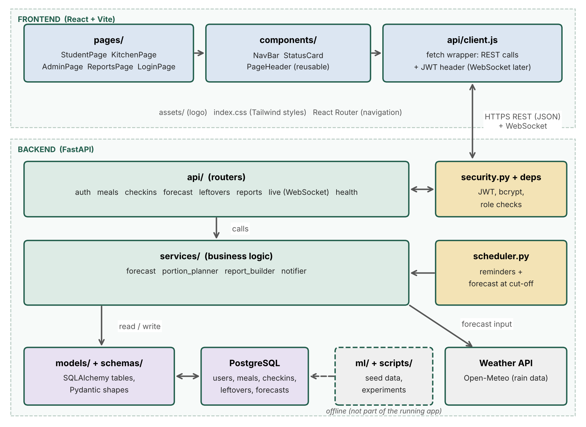

# MessMeter Architecture

MessMeter is a full-stack web application: a **React** frontend talks to a **FastAPI** backend over REST (and WebSocket for
live counts), and the backend stores data in **PostgreSQL**.

## 1. What the system does: inputs, processes, outputs

| Inputs | Processes | Outputs |
| --- | --- | --- |
| Student check-ins (Eating / Skipping) | Authenticate users and check their role | Live counts: responded, eating |
| Menus, cut-off times, portion sizes (admin) | Validate and store check-ins before the cut-off | Predicted headcount with a low-high range |
| Past attendance records | Estimate eaters among students who did not respond | Portion plan (kg / litres per dish) |
| Weather, exam and holiday calendar | Forecast the headcount; convert it to portions | Weekly waste, cost and accuracy reports |
| Leftover quantities and meal ratings | Compare forecast with actual and learn | Reminders before the cut-off |

## 2. Modules

| # | Module | Where it lives | Responsibility | Built |
| --- | --- | --- | --- | --- |
| 1 | Data layer | `backend/app/database.py`, `models/`, `schemas/` | Database connection and sessions, table definitions, request / response validation | Week 1 (T2) |
| 2 | Authentication and roles | `api/auth.py`, `api/deps.py`, `security.py`; `LoginPage` | Login, password hashing, JWT, student / staff / admin access rules | Week 2 (T6), Week 3 (T10) |
| 3 | Meals and menu management | `api/meals.py`, `models/meal.py`; `AdminPage` | Admin creates meals, dishes, cut-off times and portion sizes | Week 2 (T7), Week 4 (T15) |
| 4 | Check-in | `api/checkins.py`, `models/checkin.py`; `StudentPage` | Students submit or change Eating / Skipping before the cut-off | Week 2 (T8), Week 3 (T11) |
| 5 | Live kitchen dashboard | `api/live.py`; `KitchenPage` | Shows responded, eating and predicted counts in real time | Week 4 (T14, T16) |
| 6 | Notifications and scheduling | `services/notifier.py`, `scheduler.py` | Reminders before the cut-off; runs the forecast when a meal closes | Week 4 (T17) |
| 7 | Forecast | `services/forecast.py`, `api/forecast.py`, `models/forecast.py`, `ml/` | Predicts headcount and range: baseline first, XGBoost later | Week 5 (T18, T22) |
| 8 | Portion planner | `services/portion_planner.py` | Converts the predicted headcount into quantities per dish | Week 5 (T19) |
| 9 | Leftovers and feedback | `api/leftovers.py`, `models/leftover.py` | Logs cooked vs left quantities; stores meal ratings | Week 5 (T20) |
| 10 | Reports | `api/reports.py`, `services/report_builder.py`; `ReportsPage` | Weekly waste, cost and forecast-accuracy summaries | Week 5 (T21) |
| 11 | Shared frontend | `App.jsx`, `components/`, `api/client.js`, `assets/`, `index.css` | Navigation, reusable components, HTTP client, styles | Done (Day 3) |

## 3. How the layers talk to each other

- **Pages** use reusable **components** and call the backend through `api/client.js`.
- The backend **routers** (`api/`) check the user's JWT and role, then call **services** for the real work.
- **Services** read and write data through the **models** and use outside data (weather).
- The **scheduler** triggers services at set times, so no user has to press a button.
- `ml/` and `scripts/` are offline helpers (seed data, experiments); they are not part of the running app.

**Example: a student checks in**

1. The student opens `StudentPage` and taps *Eating*.
2. `api/client.js` sends `POST /api/checkins` with the JWT.
3. `deps.py` verifies the token and the student role.
4. `api/checkins.py` checks that the meal's cut-off has not passed and saves the check-in.
5. The new count is pushed over the WebSocket to `KitchenPage`.
6. At the cut-off, `scheduler.py` triggers `services/forecast.py`; `portion_planner.py` turns the result into a portion plan.

## 4. Development order

The modules are built in dependency order, matching the development plan:

1. **Data layer** (Week 1): nothing else works without tables.
2. **Authentication, meals, check-in APIs** (Week 2): the core backend.
3. **Student pages and shared frontend** (Week 3): first usable screen.
4. **Live dashboard, admin panel, notifications** (Week 4): the Must Have loop is complete.
5. **Forecast, portion planner, leftovers, reports** (Week 5): the intelligence layer.
6. **Testing, deployment, pilot** (Week 6).
