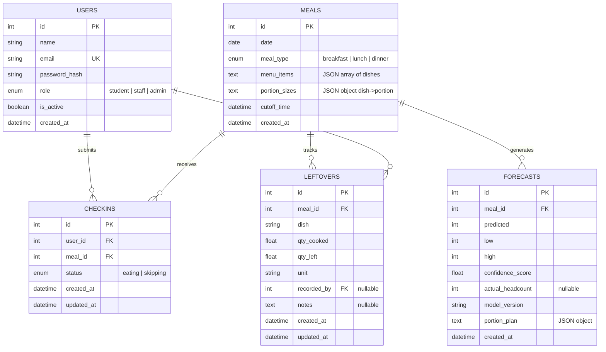

# MessMeter — Database Design & Integration (Phase 1, Day 9)

## 1. Database Fundamentals & Technology Choice

MessMeter manages structured, relational hostel mess data where referential integrity between students, scheduled meals, attendance check-ins, headcount forecasts, and kitchen leftovers is critical.

- **Primary / Production Database:** **PostgreSQL** (hosted on **Supabase** cloud)
- **Local / Test Database:** **SQLite** (`messmeter.db` locally; in-memory `sqlite://` for automated tests)
- **ORM & Driver:** **SQLAlchemy 2.0** (`DeclarativeBase`, typed `Mapped` columns) with `psycopg2-binary` for PostgreSQL

---

## 2. Entity-Relationship (ER) Schema Diagram

---

## 3. Tables, Fields & Relationships

### `users` (`backend/app/models/user.py`)
| Column | Type | Constraints | Description |
| --- | --- | --- | --- |
| `id` | `Integer` | `PRIMARY KEY` | Unique user identifier |
| `name` | `String(100)` | `NOT NULL` | Display name |
| `email` | `String(255)` | `UNIQUE, INDEX, NOT NULL` | Lowercase login email |
| `password_hash` | `String(255)` | `NOT NULL` | Bcrypt hashed password |
| `role` | `Enum(Role)` | `NOT NULL, DEFAULT 'student'` | `student`, `staff`, or `admin` |
| `is_active` | `Boolean` | `NOT NULL, DEFAULT True` | Soft-disable flag |
| `created_at` | `DateTime(tz)` | `NOT NULL` | Account creation timestamp |

### `meals` (`backend/app/models/meal.py`)
| Column | Type | Constraints | Description |
| --- | --- | --- | --- |
| `id` | `Integer` | `PRIMARY KEY` | Unique meal identifier |
| `date` | `Date` | `INDEX, NOT NULL` | Scheduled meal date |
| `meal_type` | `Enum(MealType)` | `NOT NULL` | `breakfast`, `lunch`, or `dinner` |
| `menu_items` | `Text` | `NOT NULL, DEFAULT '[]'` | JSON-serialized list of dishes |
| `portion_sizes` | `Text` | `NOT NULL, DEFAULT '{}'` | JSON map of dish to portion size |
| `cutoff_time` | `DateTime(tz)` | `NOT NULL` | Deadline for student check-ins |
| `created_at` | `DateTime(tz)` | `NOT NULL` | Creation timestamp |

### `checkins` (`backend/app/models/checkin.py`)
| Column | Type | Constraints | Description |
| --- | --- | --- | --- |
| `id` | `Integer` | `PRIMARY KEY` | Unique check-in identifier |
| `user_id` | `Integer` | `FK -> users.id (CASCADE), INDEX` | Student who checked in |
| `meal_id` | `Integer` | `FK -> meals.id (CASCADE), INDEX` | Target meal |
| `status` | `Enum(AttendanceStatus)` | `NOT NULL` | `eating` or `skipping` |
| `created_at` | `DateTime(tz)` | `NOT NULL` | Initial check-in timestamp |
| `updated_at` | `DateTime(tz)` | `NOT NULL` | Last modified timestamp |
| *Constraint* | `UniqueConstraint` | `(user_id, meal_id)` | One check-in per student per meal |

### `forecasts` (`backend/app/models/forecast.py`)
| Column | Type | Constraints | Description |
| --- | --- | --- | --- |
| `id` | `Integer` | `PRIMARY KEY` | Unique forecast identifier |
| `meal_id` | `Integer` | `FK -> meals.id (CASCADE), INDEX` | Target meal |
| `predicted` | `Integer` | `NOT NULL` | Predicted headcount |
| `low` | `Integer` | `NOT NULL` | Lower confidence bound |
| `high` | `Integer` | `NOT NULL` | Upper confidence bound |
| `confidence_score` | `Float` | `NOT NULL, DEFAULT 0.85` | Model confidence (0.0–1.0) |
| `actual_headcount` | `Integer` | `NULLABLE` | Observed headcount after meal |
| `model_version` | `String(50)` | `NOT NULL, DEFAULT 'baseline-v1'` | Forecast model identifier |
| `portion_plan` | `Text` | `NOT NULL, DEFAULT '{}'` | JSON-serialized dish quantities |
| `created_at` | `DateTime(tz)` | `NOT NULL` | Forecast generation timestamp |

### `leftovers` (`backend/app/models/leftover.py`)
| Column | Type | Constraints | Description |
| --- | --- | --- | --- |
| `id` | `Integer` | `PRIMARY KEY` | Unique leftover record ID |
| `meal_id` | `Integer` | `FK -> meals.id (CASCADE), INDEX` | Target meal |
| `dish` | `String(120)` | `NOT NULL` | Dish name |
| `qty_cooked` | `Float` | `NOT NULL` | Total quantity prepared |
| `qty_left` | `Float` | `NOT NULL` | Unconsumed quantity (`<= qty_cooked`) |
| `unit` | `String(20)` | `NOT NULL, DEFAULT 'kg'` | Measurement unit (`kg`, `L`, `pcs`) |
| `recorded_by` | `Integer` | `FK -> users.id (SET NULL), NULLABLE` | Staff/admin who logged it |
| `notes` | `Text` | `NULLABLE` | Optional kitchen remarks |
| `created_at` | `DateTime(tz)` | `NOT NULL` | Creation timestamp |
| `updated_at` | `DateTime(tz)` | `NOT NULL` | Last update timestamp |

---

## 4. Database Connection & Security

`backend/app/database.py` reads `DATABASE_URL` from `.env` (via `app.config.settings`):
- Normalizes `postgresql://` to `postgresql+psycopg2://` for SQLAlchemy.
- Configures `check_same_thread=False` when running on SQLite.
- Enables `pool_pre_ping=True` to automatically recover stale cloud PostgreSQL connections.
- Provides a per-request `get_db()` dependency that safely closes sessions after each request.
- **Connectivity Verification:** `GET /api/health` executes `SELECT 1` against the active session and reports `"database": "connected"` and the active SQLAlchemy dialect (`postgresql` or `sqlite`).
- **Secret Hygiene:** `.env` and `*.db` are listed in `.gitignore`. Only `.env.example` (containing placeholder values) is committed to GitHub.

---

## 5. CRUD Operations Implemented

| Operation | Entity | Endpoint | Description |
| --- | --- | --- | --- |
| **Create** | Users | `POST /api/users` | Admin creates a new student/staff/admin user |
| **Create** | Meals | `POST /api/meals` | Admin schedules a meal with dishes, portions, and cutoff |
| **Create** | Leftovers | `POST /api/leftovers` | Staff/admin logs cooked vs leftover dish quantities |
| **Read** | Users | `GET /api/users` | Admin lists all users ordered by ID |
| **Read** | Meals | `GET /api/meals`, `/today`, `/{id}` | Retrieve scheduled meals and student check-in state |
| **Read** | Check-ins | `GET /api/checkins/me`, `/meal/{id}` | Read student check-in history and live meal counts |
| **Read** | Forecasts | `GET /api/forecast/{meal_id}` | Retrieve or compute headcount forecast & portion plan |
| **Read** | Leftovers | `GET /api/leftovers?meal_id=` | Retrieve leftover records optionally filtered by meal |
| **Read** | Health | `GET /api/health` | Verifies live database connectivity (`SELECT 1`) |
| **Update** | Users | `PATCH /api/users/{user_id}` | Activate or deactivate user accounts |
| **Update** | Meals | `PATCH /api/meals/{meal_id}` | Update dishes, portion sizes, or cut-off time |
| **Update** | Check-ins | `POST /api/checkins` | Upsert (create or update) attendance before cut-off |
| **Update** | Leftovers | `PATCH /api/leftovers/{id}` | Modify cooked/left quantities or notes |
| **Delete** | Meals | `DELETE /api/meals/{meal_id}` | Delete a scheduled meal (cascades check-ins/forecasts/leftovers) |
| **Delete** | Leftovers | `DELETE /api/leftovers/{id}` | Remove a leftover record |

---

## 6. Challenges Encountered & Solutions

1. **Multi-Dialect Compatibility (PostgreSQL vs SQLite):**
   - *Challenge:* PostgreSQL natively supports `ARRAY`/`JSONB` and timezone-aware `DateTime`, whereas SQLite returns timezone-naive datetimes and lacks native `ENUM`/`ARRAY` types.
   - *Solution:* Used `Enum(..., native_enum=False)` and JSON-serialized `Text` columns with `@property` helpers (`dishes`, `portions`), plus explicit `tzinfo` normalization in `Meal.is_open` and `create_meal`/`update_meal`.
2. **Driver Normalization for Supabase:**
   - *Challenge:* Cloud providers supply `postgresql://` URLs, which can fail if `psycopg` v3 is not installed.
   - *Solution:* `backend/app/database.py` normalizes `postgresql://` to `postgresql+psycopg2://` and uses `pool_pre_ping=True`.
3. **Preventing Duplicate Check-ins & Meals:**
   - *Challenge:* Concurrent student taps or double-submissions could create duplicate attendance rows.
   - *Solution:* Added `UniqueConstraint("user_id", "meal_id", name="uq_user_meal_checkin")` on `checkins` and an explicit conflict check on `(date, meal_type)` in `meals`.
4. **Offline / Sandboxed Resilience:**
   - *Challenge:* When cloud PostgreSQL is unreachable (e.g., offline dev or CI), the app should not crash on startup.
   - *Solution:* `lifespan` in `main.py` catches `OperationalError` with a warning, and `GET /api/health` reports `"database": "disconnected"` cleanly without exposing connection strings.
