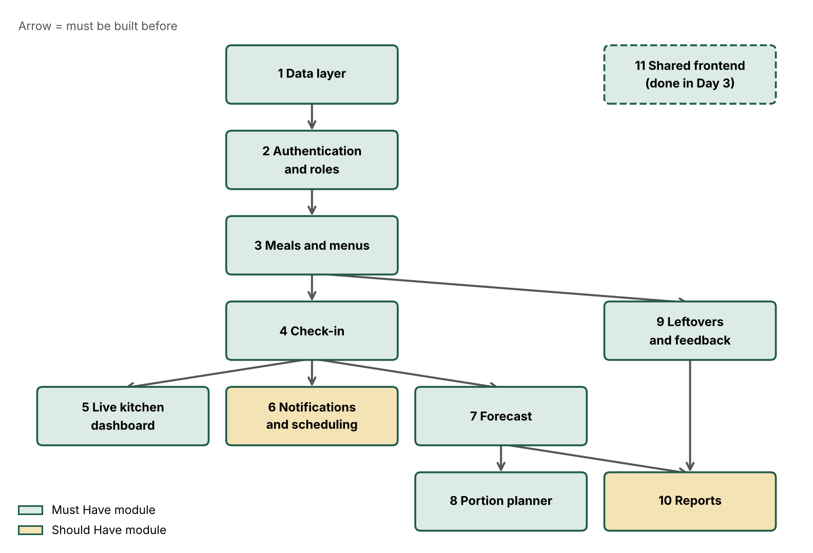

# MessMeter - Requirements Analysis and Module Planning

Phase 1, Day 4 of the UNAI TECH Virtual Internship 2026. This document states what MessMeter must do, how it is split into features and modules, what is built first, and the tasks needed to build it. It refines the plan in `docs/planning/` and the module layout in [`ARCHITECTURE.md`](ARCHITECTURE.md).

## 1. Overview

| Item | Detail |
| --- | --- |
| **Problem** | Hostel messes cook for a fixed headcount, but real attendance changes every day. Food is either wasted or runs out, the cost is passed on to students, and cooks plan by guesswork because they have no advance data. |
| **Goal** | Let students tell the mess whether they will eat each meal, and give the kitchen a predicted headcount and a portion plan before cooking starts. |
| **Scope** | One hostel mess, three meals a day, three user roles (student, kitchen staff, admin), delivered as a mobile-friendly web app within a 6-week internship. |
| **Out of scope** | Native mobile app, payments or mess-fee billing, multi-hostel support, supplier ordering, RFID or biometric attendance. |
| **Assumptions** | Simulated attendance data is used first and replaced by real pilot data later; free-tier hosting; one developer working about 15-18 hours a week. |

## 2. Requirements

### 2.1 Functional requirements (what the system does)

| ID | Module | Requirement | Priority |
| --- | --- | --- | --- |
| FR-01 | Authentication | Users log in with email and password. | Must |
| FR-02 | Authentication | The system has three roles (student, staff, admin); each role can open only its own pages and API routes. | Must |
| FR-03 | Authentication | An admin can create and deactivate user accounts. | Must |
| FR-04 | Meals | An admin can create a meal with date, type (breakfast / lunch / dinner), dishes and a cut-off time. | Must |
| FR-05 | Meals | An admin can set the portion size per person for each dish. | Must |
| FR-06 | Meals | Every logged-in user can see today's meals and menu. | Must |
| FR-07 | Check-in | A student can mark Eating or Skipping for an open meal. | Must |
| FR-08 | Check-in | A student can change the choice until the cut-off; after the cut-off the system rejects changes. | Must |
| FR-09 | Check-in | A student can rate a meal after it is served. | Should |
| FR-10 | Dashboard | Kitchen staff see, per meal, the number responded, eating, skipping and not responded. | Must |
| FR-11 | Dashboard | The counts refresh automatically without reloading the page (30-second refresh; live push if time allows). | Must |
| FR-12 | Forecast | The system predicts the final headcount with a low-high range for each meal. | Must |
| FR-13 | Forecast | Students who did not respond are estimated from past behaviour (their own or the hostel average). | Must |
| FR-14 | Forecast | The system stores each forecast and later compares it with the actual headcount. | Must |
| FR-15 | Portion planner | The system converts the predicted headcount into quantity per dish (kg / litres / pieces). | Must |
| FR-16 | Leftovers | Kitchen staff record the quantity cooked and the quantity left for each dish after a meal. | Must |
| FR-17 | Reports | An admin can view weekly waste and forecast accuracy. | Should |
| FR-18 | Notifications | Students who have not responded receive a reminder before the cut-off. | Should |

### 2.2 Non-functional requirements (how the system performs)

| ID | Category | Requirement |
| --- | --- | --- |
| NFR-01 | Performance | Pages load in under 3 seconds on a typical mobile connection; a check-in request is answered in under 500 ms for a mess of about 500 students. |
| NFR-02 | Usability | A student can complete a check-in in at most 2 taps; the interface is mobile-first and readable on small screens. |
| NFR-03 | Security | Passwords are stored hashed; sessions use expiring tokens; every API route checks the user's role; no secrets are stored in the repository. |
| NFR-04 | Privacy | Only meal intent is stored (no location or other tracking); kitchen staff see totals, not individual choices. |
| NFR-05 | Reliability | A check-in is saved before the student sees a confirmation, so no confirmed choice is lost; the database can be exported with one command. |
| NFR-06 | Accuracy | On test data, the forecast error (MAPE) must be lower than the fixed-headcount method it replaces. |
| NFR-07 | Compatibility | Works in the latest Chrome, Edge and Firefox, and in Chrome on Android, without installing an app. |
| NFR-08 | Maintainability | Code follows the documented module structure; core APIs have automated tests; the README explains setup in a few commands. |
| NFR-09 | Availability | The demo is deployed on free-tier hosting; a local Docker setup is the fallback if the host is slow or asleep. |

### 2.3 User requirements (what users expect)

| User | Expectation |
| --- | --- |
| Student | Answer in a second, see what is on the menu, and change my mind before the cut-off without calling anyone. |
| Kitchen staff / cook | Know how many people will eat and how much to cook before I start, on one simple screen, with a clear range rather than a single guess. |
| Warden / admin | Set menus and portion sizes easily, and see how much food was wasted and whether the forecast is getting better. |
| All users | Works on my phone browser with no installation, loads quickly, and keeps my information private. |

## 3. Feature breakdown

| Feature | Purpose | Input | Processing | Output | Priority |
| --- | --- | --- | --- | --- | --- |
| **F1 Login and roles** | Make sure each person sees only what their role allows. | Email and password; role set by admin. | Validate input, check hashed password, issue an expiring token, check the role on every request. | Signed-in session and role-specific pages; clear error for wrong login. | Must |
| **F2 Meal and menu management** | Give the system the meals, dishes, cut-off times and portion sizes everything else depends on. | Meal date and type, dishes, cut-off time, portion size per dish. | Validate and save; reject cut-off times in the past. | List of meals for the day with menu and cut-off. | Must |
| **F3 One-tap check-in** | Collect each student's intent (the main data source). | Meal and choice (Eating / Skipping). | Check role and cut-off, save or update the single check-in for that student and meal. | Confirmation showing the current choice; error if the meal is closed. | Must |
| **F4 Kitchen dashboard** | Show the cook the situation before cooking starts. | Check-ins for the selected meal. | Count responded, eating, skipping and not responded; refresh every 30 seconds. | Count cards and forecast panel on the Kitchen page. | Must |
| **F5 Headcount forecast** | Replace guesswork with a predicted headcount and range. | Eating count at cut-off, past attendance, weekday and meal type. | Baseline: eating count + estimated eaters among non-responders; range from past forecast errors. | Predicted headcount, low and high value, saved with the meal. | Must |
| **F6 Portion plan** | Turn the headcount into something the cook can act on. | Predicted headcount, portion size per dish. | Multiply headcount by portion size and round to practical units. | Quantity per dish (kg / litres / pieces) shown on the dashboard. | Must |
| **F7 Leftover logging** | Record what really happened so the system can learn and waste can be measured. | Quantity cooked and quantity left per dish; actual headcount. | Validate and save; attach the actual headcount to the forecast record. | Saved leftover record; forecast row now has an actual value. | Must |
| **F8 Weekly reports** | Show whether waste is falling and the forecast is improving. | Leftover records and forecasts for a week. | Sum cooked vs left per week; compute forecast error (MAPE) against the baseline. | Waste and accuracy charts on the Reports page. | Should |
| **F9 Meal reminders** | Raise the response rate before the cut-off. | Meal cut-off time and the list of students not yet responded. | Scheduler checks shortly before the cut-off and sends a reminder. | Reminder received by the student. | Should |
| **F10 Meal rating** | Tell the warden which dishes students like. | 1-5 rating for a served meal. | Save one rating per student per meal. | Average rating per meal in the admin view. | Should |
| **F11 Live dashboard updates** | Update counts instantly instead of every 30 seconds. | New check-ins as they arrive. | Backend pushes each change over a WebSocket. | Counts change on screen without a refresh. | Should |
| **F12 Installable web app (PWA)** | Let students open MessMeter like an app on their phone. | Web app manifest and service worker. | Browser offers Add to Home Screen; static files are cached. | App icon on the phone that opens the check-in page. | Should |
| **F13 ML forecast upgrade** | Improve accuracy once enough data exists. | Weather, exam and holiday flags plus past data. | Train an XGBoost model; use it only if it beats the baseline on test data. | Forecast with lower error than the baseline. | Should |

## 4. Module breakdown

| ID | Module | Responsibility | Depends on | Priority | Week |
| --- | --- | --- | --- | --- | --- |
| M1 | Data layer | Database connection, tables, request / response validation | - | Must | 1 |
| M2 | Authentication and roles | Login, password hashing, tokens, role checks | M1 | Must | 2-3 |
| M3 | Meals and menus | Meals, dishes, cut-off times, portion sizes | M1, M2 | Must | 2, 4 |
| M4 | Check-in | Eating / Skipping choices, cut-off rule, meal rating | M2, M3 | Must | 2-3 |
| M5 | Live kitchen dashboard | Counts and forecast panel for the cook | M4 | Must | 4 |
| M6 | Notifications and scheduling | Reminders; runs the forecast when a meal closes | M3, M4 | Should | 4 |
| M7 | Forecast | Headcount prediction and range | M1, M4 | Must | 5 |
| M8 | Portion planner | Headcount to quantity per dish | M3, M7 | Must | 5 |
| M9 | Leftovers and feedback | Cooked vs left quantities, actual headcount | M3 | Must | 5 |
| M10 | Reports | Weekly waste and accuracy | M7, M9 | Should | 5 |
| M11 | Shared frontend | Navigation, components, API client, styles | - | Must | Done |

Modules are built in dependency order: a module is started only when the modules it depends on work.

## 5. Feature prioritization (MoSCoW)

| Feature | How it helps solve the problem | Priority | Reason |
| --- | --- | --- | --- |
| F1 Login and roles | Keeps staff and admin data protected and tells users apart | Must | Every other feature needs to know who the user is. |
| F2 Meal and menu management | Defines what is being forecast | Must | No meals, no check-ins. |
| F3 One-tap check-in | Collects the signal that removes guesswork | Must | The core data source. |
| F4 Kitchen dashboard | Puts the signal in front of the cook | Must | Without it the data is not used. |
| F5 Headcount forecast | Directly prevents over- and under-cooking | Must | The central promise of the project. |
| F6 Portion plan | Turns the forecast into an action | Must | A headcount alone does not tell the cook what to make. |
| F7 Leftover logging | Measures waste and gives the forecast its truth | Must | Needed to check and improve accuracy. |
| F8 Weekly reports | Proves waste is falling | Should | Valuable evidence, but the core loop works without it. |
| F9 Meal reminders | Raises response rate and so accuracy | Should | Helps, but students can still check in without it. |
| F10 Meal rating | Links waste to unpopular dishes | Should | Useful extra signal for menus. |
| F11 Live dashboard updates | Makes counts instant | Should | 30-second refresh already meets the need. |
| F12 Installable web app | Makes check-in faster to reach | Should | Browser access already works. |
| F13 ML forecast upgrade | Improves accuracy | Should | Baseline is enough for a working product. |
| Could Have items | Convenience and polish | Could | Only if Weeks 1-5 finish early. |

**Could Have (only if time permits):** Points for regular responders (encourage students to answer every meal); Menu popularity insights (rank dishes by turnout and rating to help redesign menus); Offline check-in queue (keep a check-in made without network and send it when the connection returns); CSV export of reports (let the warden open reports in a spreadsheet); Dark mode (easier reading at night).

**Won't Have (out of scope):** native mobile app, payments or billing, multi-hostel support, supplier ordering, RFID or biometric attendance.

## 6. Development task list

51 tasks (42 Must Have, 9 Should Have), each small enough to finish and test independently. M = Must Have, S = Should Have. These refine tasks T1-T26 of the development plan.

### M1 Data layer

| ID | Task | Priority | Week |
| --- | --- | --- | --- |
| DB-1 | Write SQLAlchemy models for users, meals, checkins, leftovers and forecasts | Must | 1 |
| DB-2 | Set up Alembic and create the first migration | Must | 1 |
| DB-3 | Write Pydantic schemas for each model | Must | 1 |
| DB-4 | Start PostgreSQL with Docker and test the connection from the app | Must | 1 |
| DB-5 | Write a script that generates simulated attendance data (weekday, exam and rain effects) | Must | 1 |

### M2 Authentication and roles

| ID | Task | Priority | Week |
| --- | --- | --- | --- |
| AUTH-1 | Write the password hashing helper (bcrypt) | Must | 2 |
| AUTH-2 | Write JWT creation and verification helpers | Must | 2 |
| AUTH-3 | Create POST /api/auth/login with input validation | Must | 2 |
| AUTH-4 | Add a role-check dependency (student / staff / admin) | Must | 2 |
| AUTH-5 | Add an admin endpoint to create and deactivate users; seed one admin | Must | 2 |
| AUTH-6 | Test valid login, wrong password and wrong role | Must | 2 |
| AUTH-7 | Build the Login page form with validation, error messages and role-based redirect | Must | 3 |
| AUTH-8 | Add a protected-route component that blocks pages by role | Must | 3 |

### M3 Meals and menus

| ID | Task | Priority | Week |
| --- | --- | --- | --- |
| MEAL-1 | Create and list meals API (admin) with dishes and cut-off time | Must | 2 |
| MEAL-2 | Create GET /api/meals/today for all roles | Must | 2 |
| MEAL-3 | Add portion size per dish (model and API) | Must | 2 |
| MEAL-4 | Test meal creation and validation (past cut-off, missing dishes) | Must | 2 |
| MEAL-5 | Build the admin meal form and meal list | Must | 4 |

### M4 Check-in

| ID | Task | Priority | Week |
| --- | --- | --- | --- |
| CHK-1 | Create POST /api/checkins for Eating / Skipping | Must | 2 |
| CHK-2 | Reject check-ins after the cut-off; allow changes before it | Must | 2 |
| CHK-3 | Test before / after cut-off, repeat check-in and wrong role | Must | 2 |
| CHK-4 | Student page: show today's meals with Eating / Skipping buttons | Must | 3 |
| CHK-5 | Show confirmation, current choice and error messages | Must | 3 |
| CHK-6 | Add the meal rating API and one-tap rating control | Should | 3 |

### M5 Live kitchen dashboard

| ID | Task | Priority | Week |
| --- | --- | --- | --- |
| DASH-1 | Create the counts API (responded, eating, skipping, not responded) | Must | 4 |
| DASH-2 | Kitchen page: count cards with 30-second auto-refresh | Must | 4 |
| DASH-3 | Test the counts API with sample check-ins | Must | 4 |
| DASH-4 | Add WebSocket live updates for the counts | Should | 4 |

### M6 Notifications and scheduling

| ID | Task | Priority | Week |
| --- | --- | --- | --- |
| NOTE-1 | Scheduler job that finds students who have not responded before the cut-off | Should | 4 |
| NOTE-2 | Send the reminder (browser notification or email) | Should | 4 |
| NOTE-3 | Trigger the forecast automatically at each cut-off | Should | 5 |

### M7 Forecast

| ID | Task | Priority | Week |
| --- | --- | --- | --- |
| FCST-1 | Baseline: average attendance by weekday and meal type | Must | 5 |
| FCST-2 | Estimate eaters among non-responders from past behaviour | Must | 5 |
| FCST-3 | Calculate the low-high range from past errors and store the forecast | Must | 5 |
| FCST-4 | Create GET /api/forecast/{meal_id} | Must | 5 |
| FCST-5 | Evaluate against the fixed-headcount method (MAPE) on simulated data | Must | 5 |
| FCST-6 | XGBoost model with weather and calendar features; keep only if it beats the baseline | Should | 5 |

### M8 Portion planner

| ID | Task | Priority | Week |
| --- | --- | --- | --- |
| PORT-1 | Write the headcount-to-quantity function with unit rounding | Must | 5 |
| PORT-2 | Unit tests for edge cases (zero headcount, rounding, missing portion size) | Must | 5 |
| PORT-3 | Show the portion plan on the Kitchen page | Must | 5 |

### M9 Leftovers and feedback

| ID | Task | Priority | Week |
| --- | --- | --- | --- |
| LEFT-1 | Create POST /api/leftovers | Must | 5 |
| LEFT-2 | Leftover form on the Kitchen page | Must | 5 |
| LEFT-3 | Save the actual headcount on the forecast record after the meal | Must | 5 |
| LEFT-4 | Test saving and validation of leftover records | Must | 5 |

### M10 Reports

| ID | Task | Priority | Week |
| --- | --- | --- | --- |
| REP-1 | Query weekly waste (cooked vs left) | Should | 5 |
| REP-2 | Query forecast accuracy (MAPE) | Should | 5 |
| REP-3 | Reports page with charts (Recharts) | Should | 5 |

### Release

| ID | Task | Priority | Week |
| --- | --- | --- | --- |
| REL-1 | Dockerise backend and frontend | Must | 6 |
| REL-2 | Deploy and test on a phone | Must | 6 |
| REL-3 | Run a pilot with classmates or a mess; record response rate and forecast error | Must | 6 |
| REL-4 | Final README, demo video and report | Must | 6 |
